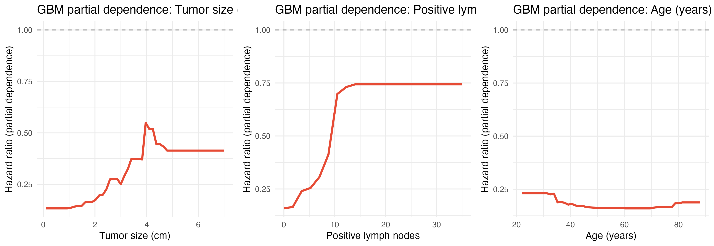

# Breast Cancer Survival Analysis — Cox vs. Machine Learning

**Predicting overall survival in 1,207 breast-cancer patients: a rigorous comparison of classical survival models (Cox proportional hazards) and machine-learning survival models (regularized Cox, GBM, Random Survival Forest, XGBoost), with leak-free cross-validation, time-dependent AUC, and model interpretability.**

> 中文简介见文末 [中文摘要](#中文摘要)。

---

## Key results

| Model | C-index (5×5-fold CV, mean ± SD) |
|---|---|
| Cox ElasticNet | 0.740 ± 0.009 |
| Cox Lasso | 0.739 ± 0.009 |
| Cox Ridge | 0.727 ± 0.020 |
| Cox PH | 0.716 ± 0.023 |
| Random Survival Forest | 0.693 ± 0.016 |
| XGBoost (Cox) | 0.682 ± 0.013 |
| GBM | 0.679 ± 0.034 |

<p align="center">
  
</p>

Headline finding: **regularized Cox models (ElasticNet / Lasso) generalize
best** in this low-event setting (72 events / ~6%), while the tree ensembles
underperform despite their flexibility — and still surface non-linear structure
the linear models miss, most notably a **U-shaped effect of age** on mortality
risk.

---

## What this project demonstrates

- **Full survival-analysis pipeline**: data cleaning → missing-data diagnostics → multiple imputation (MICE) → EDA → modeling → evaluation → interpretability.
- **Statistical rigor**: MICE-pooled Cox inference, collinearity (VIF/GVIF), proportional-hazards (Schoenfeld) diagnostics, and a **leak-free** train/test protocol (imputation and model fitting confined to the training fold).
- **Model comparison done honestly**: repeated 5-fold CV with mean ± SD, Harrell's C-index, and time-dependent AUC (IPCW via `timeROC`).
- **Interpretability of black-box models**: permutation variable importance (RSF), partial-dependence plots (GBM), and SHAP values (XGBoost).

---

## Repository structure

```
breast-cancer-survival-ml/
├── analysis/
│   └── run_all.R            # entry point: sources R/ modules in order
├── R/
│   ├── 00_setup.R           # packages, seed, constants, helpers
│   ├── 01_load_clean.R      # load, recode, missing-data diagnostics, MICE
│   ├── 02_eda.R             # distribution plots + Table 1
│   ├── 03_inference.R       # KM curves, pooled Cox, VIF/PH, forest plot
│   ├── 04_ml_models.R       # 7 survival models + leak-free imputation
│   ├── 05_evaluation.R      # repeated CV: C-index + time-dependent AUC
│   └── 06_interpret.R       # VIMP, PDP, SHAP
├── data/
│   ├── raw/                 # original .sav + CSV export
│   └── README.md            # data dictionary
├── output/                  # generated figures + tables
├── install.R                # one-shot dependency installer
└── .Rprofile                # uses the project-local lib/
```

---

## Quick start

Requirements: **R ≥ 4.1** (developed on R 4.6). No system packages needed.

```bash
# 1. install dependencies into the project-local lib/ (one time)
Rscript install.R

# 2. run the full pipeline (figures/tables -> output/)
Rscript analysis/run_all.R
```

The entry point `analysis/run_all.R` locates the project root from its own path,
so it can be run from any working directory. Results are written to
`output/figures/` (PNG, 300 dpi) and `output/tables/` (CSV), and a
`sessionInfo()` snapshot is saved for reproducibility.

---

## Methodology

**Data.** The Kaggle public dataset *"Breast Cancer Survival"* — 1,207 patients,
9 variables (age, tumor size, positive lymph nodes, histologic grade, ER/PR
status, survival time, event indicator). Outcome = overall survival (OS);
only 72 events (~6%) makes this a realistic low-event, low-dimensional stress
test.

**Two analysis branches:**

1. **Inference** — Kaplan-Meier curves, multivariable Cox proportional-hazards
   model, and model diagnostics. Missing values (up to 29% in some variables)
   are handled with MICE multiple imputation (m = 5), and Cox estimates are
   pooled with Rubin's rules.

2. **Prediction** — seven survival models compared by repeated 5-fold CV:
   - *Semi-parametric*: Cox PH (baseline), Cox with Lasso / Ridge / Elastic-Net
     regularization (`glmnet`).
   - *Machine learning*: Gradient Boosting Machine (`gbm`, Cox loss), Random
     Survival Forest (`randomForestSRC`), and XGBoost (`survival:cox`).

   To prevent data leakage, median/mode imputation is **fit on each training
   fold and applied to the held-out fold only**. Discrimination is quantified
   by Harrell's C-index (mean ± SD over CV repeats) and time-dependent AUC.

**Design note.** Linear models use clinically-standard lymph-node cutpoints
(0 / 1–3 / >3); tree models use the raw continuous count to retain full signal.

---

## Key findings

- **Tumor size and lymph-node involvement dominate prognosis** (HR ≈ 1.4 per cm
  and HR ≈ 3.3 for >3 positive nodes, both p < 0.001 in the pooled Cox model).
- **Histologic grade, ER and PR status lose significance after adjusting for
  tumor burden**, suggesting their effect is largely mediated through tumor size
  and nodal spread.
- **Regularized Cox models win** in this low-event setting: ElasticNet and Lasso
  slightly outperform plain Cox PH, while GBM / RSF / XGBoost do not improve
  discrimination — consistent with the literature on clinical prediction models
  (Christodoulou et al., 2019).
- **But ML reveals non-linearity**: GBM and XGBoost uncover a **U-shaped age
  effect** — very young (< 35) and elderly (> 80) patients both face elevated
  risk — which a linear Cox model cannot express.

<p align="center">
  
  
</p>

---

## Reproducibility

- Single master `SEED` plus per-repeat seeds in `R/00_setup.R`.
- All packages pinned via the project-local library and recorded in
  `output/session_info.txt`.

---

## Data source & license

Dataset: [*Breast Cancer Survival* on Kaggle](https://www.kaggle.com/datasets/amandam1/breastcancerdataset)
(originally an SPSS `.sav` file). It is a public research dataset used here for
an educational portfolio project. Verify its license on Kaggle before any
commercial use or publication.

---

## Limitations & next steps

- Small event count (72) limits statistical power; results are illustrative,
  not clinical.
- Single external dataset, no independent validation cohort.
- Future work: nested CV for hyperparameter tuning, Brier score / integrated
  Brier score and calibration curves, `DeepSurv`/`CoxTime` neural survival
  models, and a Streamlit/Shiny risk calculator for demo.

---

## 中文摘要

本项目基于 Kaggle 公开数据集（1,207 例乳腺癌患者），系统比较了传统 Cox
比例风险模型与机器学习生存模型（正则化 Cox、GBM、随机生存森林、XGBoost）的
预后预测能力。项目覆盖完整的数据分析闭环：缺失值诊断与多重插补（MICE）、
描述统计、Kaplan-Meier 生存曲线、多因素 Cox 回归及假设检验（VIF、PH 检验）、
以及**防数据泄漏**的 5 折重复交叉验证（C-index 均值±SD、时间依赖 AUC）和
可解释性分析（变量重要性、PDP、SHAP）。核心结论：在低事件数（72 例事件）的
低维数据上，Cox 模型泛化能力不输机器学习模型；但机器学习模型揭示了 Cox 无法
表达的**年龄与死亡风险间的 U 型非线性关系**，体现了可解释 ML 在生存分析中的
补充价值。

*项目是研究生生物统计课程作业的工程化改造版本，目标是作为数据科学/机器学习
方向的作品集项目。*
