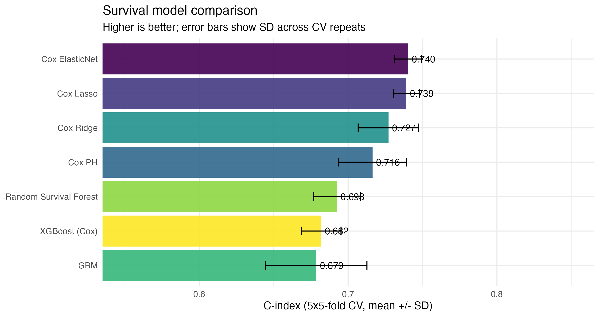
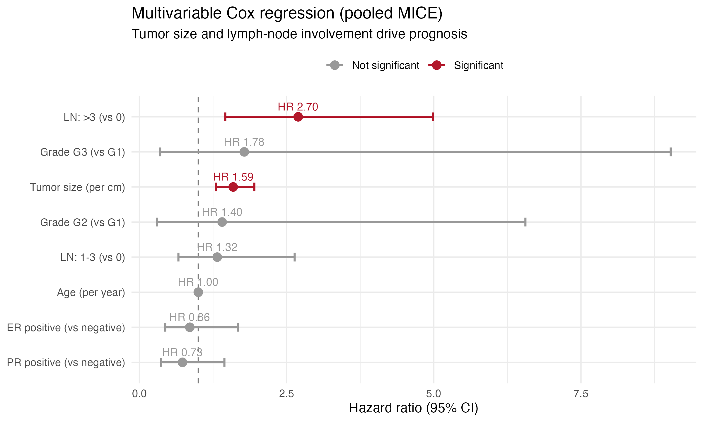
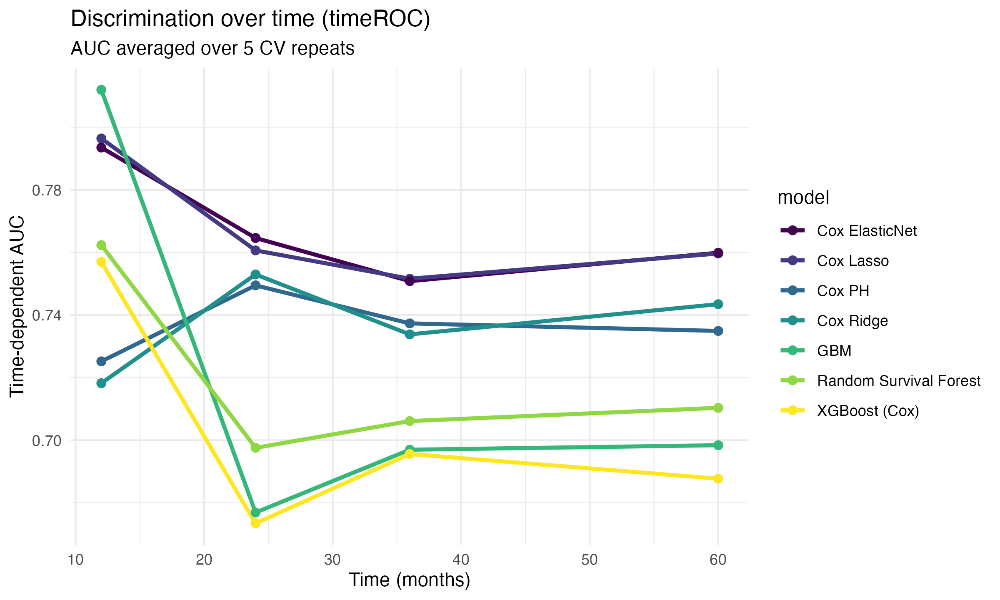

# 乳腺癌生存分析与机器学习模型比较

基于 1,207 例乳腺癌患者的公开随访数据，使用 R 完成缺失值处理、生存分析、预测建模与模型解释，比较 Cox 比例风险模型、正则化 Cox 与树模型在低事件率数据中的预测表现。

项目由生物统计课程分析扩展而来，将统计推断与预测评估分别组织为可运行的分析流程，提供模块化代码、结果表格和可视化图表。

**主要工具：** R、survival、mice、glmnet、gbm、randomForestSRC、xgboost、timeROC、shapviz、ggplot2。

## 数据与分析目标

数据来源于 Kaggle 的 [Breast Cancer Survival 数据集](https://www.kaggle.com/datasets/amandam1/breastcancerdataset)，原始文件为 SPSS 格式，分析使用仓库中的 CSV 导出文件。

| 项目 | 说明 |
| --- | --- |
| 样本量 | 1,207 例 |
| 结局 | 总生存时间（月）及死亡事件指示 |
| 事件数 | 72 例，占 5.97%；其余 1,135 例为删失观测 |
| 预测变量 | 年龄、肿瘤大小、阳性淋巴结数、组织学分级、ER 状态、PR 状态 |
| 缺失情况 | 4 个预测变量存在缺失，最高缺失比例为 29.5% |

字段定义与缺失数量见 [数据说明](data/README.md)。`id` 列不参与建模。

分析围绕两个问题展开：一是各临床特征与生存结局的统计关联，二是在事件数有限的情况下，不同生存模型的风险排序能力有何差异。

## 分析方法

### 统计推断

- 检查变量分布与缺失情况，使用 MICE 生成 5 份插补数据。
- 绘制 Kaplan–Meier 生存曲线，拟合多因素 Cox 比例风险模型。
- 按 Rubin 法则合并 Cox 回归结果，报告风险比（HR）及 95% 置信区间。
- 通过 VIF / GVIF 和 Schoenfeld 残差检查共线性及比例风险假设。

Cox 系数推断使用多重插补合并结果；描述性分析、生存曲线及模型诊断使用第 1 份插补数据。

### 预测建模与评估

比较 7 种模型：Cox PH、Cox Lasso、Cox Ridge、Cox ElasticNet、GBM、随机生存森林和 XGBoost（Cox 目标函数）。

- **数据划分：** 进行 5 次重复的 5 折交叉验证，各模型在同一次重复中使用相同的数据划分。
- **缺失值处理：** 预测分支保留原始缺失值，在每个外层训练折中计算中位数或众数，再应用于训练折和验证折。
- **参数设置：** 正则化 Cox 在外层训练数据中使用 `cv.glmnet` 选择惩罚参数；GBM、随机生存森林和 XGBoost 在评估中采用预设参数。
- **评估指标：** 每次重复合并折外预测，计算 Harrell's C-index，再汇总 5 次结果的均值与标准差；使用 `timeROC` 计算 12、24、36、60 个月的时间依赖 AUC。
- **模型解释：** 使用随机生存森林置换重要性、GBM 部分依赖图（PDP）和 XGBoost SHAP 分析模型预测与特征的关系。

Cox 系列将阳性淋巴结数划分为 0、1–3、>3 三组，树模型保留原始计数。解释性分析在全量数据上重新拟合模型，其结果用于探索模型行为。

## 主要结果

### 模型预测表现

下表来自仓库现有结果文件 [cindex_cv.csv](output/tables/cindex_cv.csv)，展示当前数据及参数设置下的评估结果。

| 模型 | C-index（均值 ± 标准差） |
| --- | --- |
| Cox ElasticNet | 0.740 ± 0.009 |
| Cox Lasso | 0.739 ± 0.009 |
| Cox Ridge | 0.727 ± 0.020 |
| Cox PH | 0.716 ± 0.023 |
| Random Survival Forest | 0.693 ± 0.016 |
| XGBoost（Cox） | 0.682 ± 0.013 |
| GBM | 0.679 ± 0.034 |

标准差反映 5 次交叉验证重复之间的波动，不是置信区间。



正则化 Cox 在本次评估中取得较高的平均 C-index，ElasticNet 与 Lasso 的结果接近。树模型在当前设置下未表现出更高的区分能力；这一排序不代表模型之间存在统计显著差异，也不能推广为算法的普遍优劣。

### Cox 回归与模型解释

根据 [多重插补合并结果](output/tables/cox_results.csv)，肿瘤大小每增加 1 cm 的 HR 为 **1.59（95% CI：1.30–1.95）**；阳性淋巴结数 >3 相对于 0 的 HR 为 **2.70（95% CI：1.46–4.99）**。这些结果描述本数据及模型设定下的调整后关联。

组织学分级、ER 和 PR 状态在该多因素模型中未达到 0.05 显著性水平，不能据此认定其没有作用，也不能推断存在中介机制。PDP 与 SHAP 用于探索非线性预测模式，不作为因果效应或临床风险规律的证据。





## 运行方式

现有运行环境记录为 **R 4.6.1**，具体包版本见 [session_info.txt](output/session_info.txt)。安装时获取的包版本可能随时间变化；部分依赖从源码安装时可能需要编译工具或系统库。

在项目根目录下执行：

```bash
Rscript install.R
Rscript analysis/run_all.R
```

`install.R` 将需要安装的依赖放入项目内的 `lib/`，由 `.Rprofile` 加入包搜索路径。完整流程将生成或覆盖以下输出：

- `output/figures/`：变量分布、缺失情况、生存曲线、回归森林图、模型比较与解释图。
- `output/tables/`：基线表、Cox 回归结果、共线性诊断、C-index、时间依赖 AUC 和变量重要性。
- `output/session_info.txt`：本次运行的 R 与依赖包版本信息。

随机种子、交叉验证次数、AUC 时间点及主要模型参数在 [R/00_setup.R](R/00_setup.R) 中配置。项目尚未使用依赖锁文件，版本记录用于追踪运行环境，不保证跨环境得到完全相同的结果。

## 项目结构

| 路径 | 内容 |
| --- | --- |
| [analysis/run_all.R](analysis/run_all.R) | 主入口，按顺序执行分析模块 |
| [R/00_setup.R](R/00_setup.R) | 依赖加载、参数设置与公共函数 |
| [R/01_load_clean.R](R/01_load_clean.R) | 数据读取、变量编码、缺失诊断与多重插补 |
| [R/02_eda.R](R/02_eda.R) | 描述性分析与基线表 |
| [R/03_inference.R](R/03_inference.R) | 生存曲线、Cox 回归与模型诊断 |
| [R/04_ml_models.R](R/04_ml_models.R) | 折内插补及各模型的训练、预测接口 |
| [R/05_evaluation.R](R/05_evaluation.R) | 重复交叉验证与指标汇总 |
| [R/06_interpret.R](R/06_interpret.R) | 变量重要性、PDP 与 SHAP |
| [data/](data/) | 原始数据、CSV 文件与字段说明 |
| [output/](output/) | 已生成的图表、结果表与环境记录 |
| [install.R](install.R) | 依赖安装脚本 |

## 局限与后续改进

- **事件数有限：** 仅有 72 例事件，部分变量缺失比例较高；估计稳定性和模型表现需结合这一数据条件解释。
- **验证范围有限：** 当前仅在单一数据集内交叉验证，尚无独立外部验证，也未评估预测校准与 Brier score。
- **比较条件有差异：** 不同模型的淋巴结变量编码与调参范围不同，结果同时受算法、特征表示和参数设置影响。
- **评估流程仍可完善：** 当前随机分折未按事件状态分层；正则化 Cox 的内层调参沿用外层训练集的插补结果。后续可将预处理纳入内层验证，并统一各模型的调参预算。
- **折外评分汇总需谨慎：** 当前 C-index 与 AUC 基于合并折外风险分数计算，不同折拟合模型的分数尺度可能存在差异；后续可补充逐折指标汇总及敏感性分析。
- **解释结果属于探索性分析：** PDP 与 SHAP 来自全量数据拟合，不能替代独立验证或因果分析。

本项目用于统计分析与预测建模实践，不用于临床决策。数据使用与再分发应遵循来源页面的许可条款。
